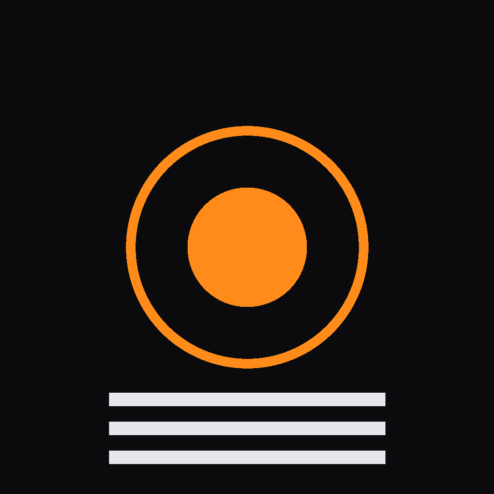

<p align="center">
  
</p>

<h1 align="center">Teleprompter Studio</h1>

<p align="center">
  <b>A teleprompter that is also the camera.</b><br>
  Write the script, read it over the live preview, and record the take on the same iPhone or iPad.
  Or keep it as the prompter and film with something else.
</p>

<p align="center">
  <a href="https://github.com/AhmedHeshamEG/teleprompter-studio/releases/latest"><b>Download the .ipa</b></a> ·
  <a href="#build-it">Build it</a> ·
  <a href="docs/NOTES.md">Engineering notes</a>
</p>

<p align="center">
  <a href="https://github.com/AhmedHeshamEG/teleprompter-studio/releases/latest"></a>
  <a href="https://github.com/AhmedHeshamEG/teleprompter-studio/actions/workflows/build-ipa.yml"></a>
  <a href="LICENSE"></a>
  
  
</p>

---

## Why

I record with a teleprompter and I improvise off it. Every prompter app I tried either sat on top of a camera app it
couldn't control, or let the phone go to sleep mid-take because nobody touches a phone on a tripod. So this one owns
the camera, keeps the screen awake, and gets out of the way of your face.

## What it does

**The prompter.** Scripts are Markdown with bold, italic, colour, highlight and LaTeX maths (KaTeX, bundled, works
offline). The text scrolls on a `CADisplayLink` through a TextKit `UITextView`, so it stays smooth at any font size on
a script of any length. Lines that start with `>` are cues: smaller, in the accent colour, so a stage direction never
gets read out loud. Photos can sit inline in a script. OpenDyslexic is one tap away.

**The card is yours.** Drag it, pinch it, park it next to the lens. One button clears every control off the screen
except the script, the timer and record. In landscape the controls move to side rails, because a landscape iPhone has
about 390 points of height and none of them are spare.

**Record mode** films the take in-app at 4K/30, stepping down to the closest format the camera really has and telling
you on screen when it does. On iPhone 13 and later with iOS 26 it shoots Apple's real Cinematic video: subject
tracking drawn over the preview, tap to rack focus, the real aperture range. **Prompt-only mode** is just the reader,
for when the camera is something else.

**Voice mode** swaps the camera for a recorder: live waveform, pause and resume into the same file, 24-bit Apple
Lossless, a takes list per script with a scrubbable player, and Lock Screen controls. Takes land in the Files app.

**Two devices.** One phone directs, the other mirrors the prompter and a live camera preview over
MultipeerConnectivity. Local network only: no internet, no account, no pairing code. They remember each other and
relink on their own when either app comes back.

**Edit from a laptop.** The app runs a small HTTP server on `Network.framework`, with no dependencies, and shows a QR
code. Open it in a browser on the same Wi-Fi and edit your scripts with a real keyboard.

Scripts are stored locally with SwiftData, in folders, with search. One build covers iPhone and iPad, portrait and
landscape, and Stage Manager.

## Install

Grab `TeleprompterStudio.ipa` from the [latest release](https://github.com/AhmedHeshamEG/teleprompter-studio/releases/latest).
It's unsigned, so sign it on the way in, with [Sideloadly](https://sideloadly.io) or `xtool dev build --sign`.
Needs iOS 17. Cinematic needs iOS 26 on a supported camera.

## Build it

It's a plain SwiftPM package built with [xtool](https://github.com/xtool-org/xtool). I write it on Windows and a
macOS runner compiles it, so you don't need Xcode. If you have Xcode, that works too.

```bash
xtool dev build          # build
xtool dev build --ipa    # unsigned .ipa
xtool dev                # build, install and run on a connected device
```

Change `bundleID` in [`xtool.yml`](xtool.yml) to your own before installing. Every push builds an `.ipa` in
[Actions](.github/workflows/build-ipa.yml).

## How it's put together

```
Sources/TeleprompterStudio/
├── App/                 entry point, Studio, Voice, settings
├── ScriptLibrary/       scripts, folders, search
├── Editor/              Markdown editor with a formatting toolbar
├── TeleprompterEngine/  the scrolling prompter and its controls
├── CameraKit/           capture session, Cinematic, zoom
├── Recorder/            movie and voice recording, take playback
├── SyncKit/             Director/Companion over MultipeerConnectivity
├── LANServer/           HTTP server and the browser editor
├── DesignSystem/        theme, fonts, shared components
├── Models/              SwiftData models
└── SharedWebResources/  vendored KaTeX and marked.js
```

The decisions that weren't obvious (threading around AVFoundation, how Cinematic picks its camera, why the
HTTP server closes after every request) are in [`docs/NOTES.md`](docs/NOTES.md).

## Licence

[MIT](LICENSE). OpenDyslexic is under the SIL Open Font License, KaTeX and marked.js under MIT.
